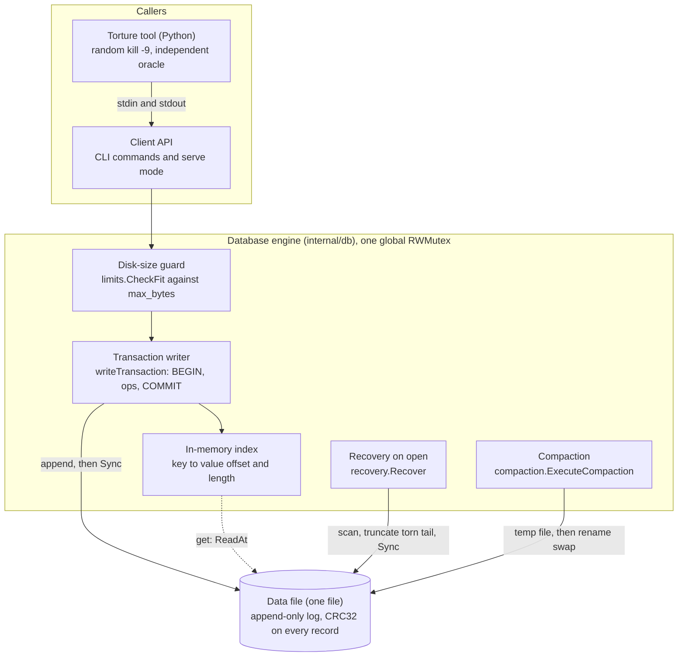
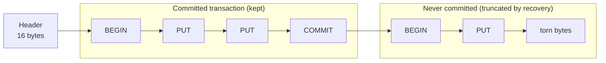
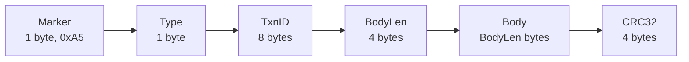
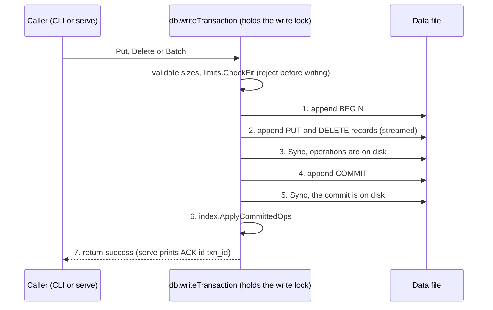
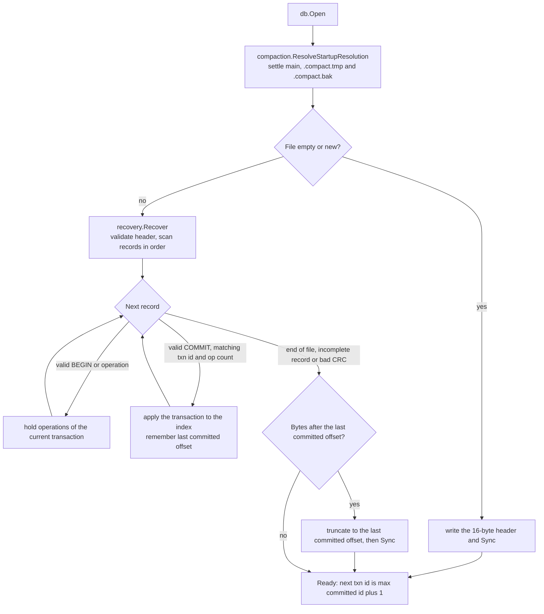
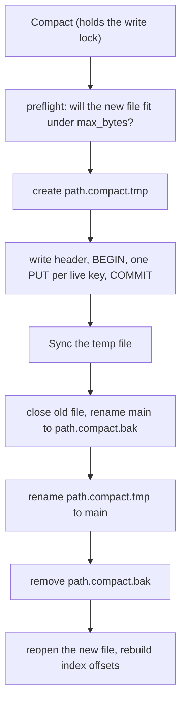

# TORQ
## 6. Architecture

TORQ is an **append-only log plus an in-memory index**. Nothing in the data file is ever edited in place: every change is appended as a *transaction* (BEGIN, operations, COMMIT), and every record carries a CRC32 checksum. After a crash, recovery keeps the committed transactions and cuts off whatever is unfinished.

### 6.1 Components

| Component | Source file | Job |
|---|---|---|
| Client API | `internal/cli/cli.go`, `cmd/kvdb/main.go` | `open`, `put`, `get`, `del`, `batch`, `dump`, `check`, `compact`, `serve` |
| Disk-size guard | `internal/limits/guard.go` | Rejects a write that would pass `max_bytes` before anything is written |
| Transaction writer | `internal/db/db.go` (`writeTransaction`) and `internal/wal/writer.go` | Appends records, calls Sync, rolls back on error |
| Record format | `internal/wal/record.go`, `reader.go`, `checksum.go` | Encodes, decodes and checksums records |
| In-memory index | `internal/index/index.go` | Maps a key to where its latest value sits in the file |
| Recovery | `internal/recovery/scanner.go` (`Recover`, `Check`) | Validates the file, rebuilds the index, truncates a torn tail |
| Compaction | `internal/compaction/compact.go` | Rewrites only live keys into a new file and swaps it in |
| Failpoints | `internal/failpoint/`, `internal/db/failpoints.go` | Named crash points for deterministic tests (`KVDB_FAILPOINT=<name>`) |
| Torture tool | `torture/torture.py` | Starts `kvdb serve`, sends random operations, kills it, verifies the result |

### 6.2 On-disk layout

The file is a 16-byte header followed by transactions, written one after another. A kill can leave an unfinished transaction at the end. It has no COMMIT, so recovery cuts it off.

Every record has the same frame (exact field table in section 2):

The CRC32 covers every byte before it. A record that was cut off mid-write fails its length or checksum test and is ignored.

### 6.3 Write path (what happens on `put`, `delete` and `batch`)

A single `put` is a transaction of one operation. A batch is one transaction, so it is all-or-nothing.

- The caller only hears success after step 5. A kill before that point leaves a transaction without a durable COMMIT, which recovery discards. The caller was never told it succeeded, so discarding it is correct.
- If a write or Sync fails, the writer truncates the file back to where the transaction started. If even that fails, the database is marked write-disabled until it is reopened.
- The index is updated only after step 5, under the same lock, so a reader never sees half a batch.

Test hooks sit between the steps. Set `KVDB_FAILPOINT` to one of these names and the process exits with code 137 at that point:

| Failpoint | Where it fires |
|---|---|
| `mid_write` | Half of an operation record is written, then the process exits |
| `after_ops_before_sync` | Operations written, step 3 not yet done |
| `after_ops_sync_before_commit` | Operations on disk, COMMIT not yet written |
| `after_commit_before_sync` | COMMIT written, step 5 not yet done |
| `after_commit_sync_before_ack` | Everything durable, success not yet returned |

### 6.4 Recovery (every `open`)

Recovery only reads the file and then makes one repair, the truncate. If the process is killed during recovery, the next `open` repeats the same steps and ends in the same state.

Failpoints in recovery: `recovery_mid_scan`, `recovery_before_truncate`, `recovery_after_truncate`.

`kvdb check <path>` runs the same scan read-only and reports `OK` or the reason.

### 6.5 Compaction

Compaction rewrites only the live keys into a new file, then swaps it in. The old file is never touched until the new one is complete and synced.

Failpoints, in order: `compaction_start`, `compaction_before_sync`, `compaction_after_sync_before_rename`, `compaction_after_rename_main_to_bak`, `compaction_after_rename_tmp_to_main`, `compaction_after_remove_bak`.

If the process dies at any of those points, the next `open` looks at which of the three files exist and picks one complete file:

| main | `.compact.tmp` | `.compact.bak` | What happened | What `open` does |
|---|---|---|---|---|
| yes | yes | no | Died before the swap | Delete the tmp file; main is untouched |
| no | yes | yes | Died between the two renames | If tmp has a valid header, promote it to main and delete bak; otherwise restore bak to main |
| yes | no | yes | Died after the swap, before cleanup | Main is already the new file; delete bak |
| yes | yes | yes | Leftovers from an unusual crash | Delete tmp and bak |
| no | no | yes | Only the backup remains | Restore bak to main |
| no | yes | no | Only the temp file remains | Promote tmp if its header is valid, else delete it |
| yes | no | no | Normal | Nothing to do |

### 6.6 Concurrency model

TORQ uses **goroutines with one global lock**, not parallel writers.

| Part | How it runs |
|---|---|
| `serve` mode | Each incoming request is handled in its own goroutine, so many requests can be in flight at once. Responses carry the request id because they may finish out of order. |
| Reads (`get`) | Take the read lock. Many reads can run at the same time. |
| Writes (`put`, `delete`, `batch`, `compact`, `close`) | Take the exclusive write lock and hold it for the whole transaction, including both Syncs and the index update. |
| Torture tool | Python threads: one sends operations, one reads acknowledgements, and a timer thread performs the kill. |

One writer at a time keeps records from interleaving in the log, which is what keeps each batch contiguous and atomic. Fsync dominates write cost, so parallel writes would not make it faster anyway.
